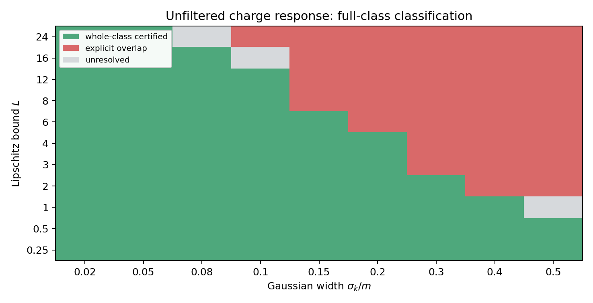

# Detector-restricted spin identifiability

**Reproducible analysis and manuscript source for charged spin-1/2 versus spin-1 identification from calibrated electromagnetic detector responses.**

[](https://github.com/dvlahek/detector-induced-spin-identifiability/actions/workflows/reproduce.yml)
[](LICENSE)
[](CITATION.cff)

**Manuscript:** *Detector-Restricted Identifiability of Charged Spin-1/2 and Spin-1 Particles: Whole-Class Certificates and Exact Degeneracies* (prepared for submission; **not yet published or peer-reviewed**).  
**Author:** Dino Vlahek, Faculty of Organization and Informatics, University of Zagreb.  
**Frozen computational snapshot:** [`5c48258f69758818e3ed524cb4d7c1e9d5697811`](https://github.com/dvlahek/detector-induced-spin-identifiability/tree/5c48258f69758818e3ed524cb4d7c1e9d5697811). The default branch may receive later documentation updates.

[Manuscript sources](manuscript_jphysa/) · [Results and evidence](docs/RESULTS.md) · [How to reproduce](docs/REPRODUCIBILITY.md) · [Scope and limitations](docs/SCOPE.md) · [Citation](#citation)

## Research question

Intrinsic spin is a representation label, but a detector records measurable responses. This project asks **when two calibrated electromagnetic response channels can distinguish charged spin-1/2 from spin-1 candidates** despite uncertain form factors and finite detector bandwidth.

The spin-1/2 candidate lacks an internal rank-2 sector. The spin-1 reference class uses the stated elementary-field relation $g_M+g_Q=1$; the analysis also treats $g_M+g_Q=1+\delta$ as an enlarged nuisance family.

> **Scientific scope.** Results are conditional on the specified positive detector-response architecture, admitted form-factor class and channel acceptance. This repository does **not** demonstrate an experimentally realized detector, a complete process-specific scattering likelihood or a new particle discovery. The collider benchmark is auxiliary, not part of the present manuscript.

## Main results

- **All-finite-bandwidth magnetic theorem:** whenever $\inf_{g\in K}|g|>0$, a strictly positive magnetic margin exists for every finite Gaussian bandwidth and finite Lipschitz bound, independently of $\delta$.
- **Broad-class finite-bandwidth map:** for $g_M\in[-4,4]$ on the $\delta=0$ slice, the 99-point grid contains **64 whole-class certificates, 33 constructive origin overlaps and 2 unresolved cases**. An unresolved point is neither a separation proof nor an overlap.
- **Nuisance robustness:** at $|\delta|\leq 0.10$, **61** grid points retain a uniform sufficient whole-class certificate.
- **Detector-acceptance sensitivity:** the specified charge acceptance is $A_C(k)=[2m/(E_k+m)]^2$. Four **fixed** alternatives $A_C^{(\alpha)}=[2m/(E_k+m)]^\alpha$ with $\alpha=0,1,2,3$ are evaluated; this is not a uniform-in-$\alpha$ theorem.
- **Constructive witnesses:** a two-kink Lipschitz family yields an endpoint sign change in each of the 33 overlap cells; continuity then establishes an exact root.



*Figure: reference-model finite-bandwidth classification. Green = certified; red = explicit overlap; gray = unresolved. See [assumptions and evidence](docs/RESULTS.md).*

## Quick reproduction check

**Environment:** Python 3.12; bounded dependencies in [`requirements.txt`](requirements.txt). From the repository root:

```bash
python -m pip install -r requirements.txt
python theory_numerics/verify_publication_tables.py

# Recompute the 99 compact-prior magnetic margins
python theory_numerics/narrow_prior_magnetic_audit.py \
  --output reproduced_results/narrow_prior_magnetic_margins.csv
```

The full finite-bandwidth classification, $\delta$ audit, distance enclosure, response-kernel identity, 33 witnesses and acceptance-sensitivity commands are in the [reproducibility guide](docs/REPRODUCIBILITY.md). The badge links to the real [GitHub Actions workflow](.github/workflows/reproduce.yml).

## Repository map

| Directory | Purpose | Main manuscript? |
| --- | --- | --- |
| [`manuscript_jphysa/`](manuscript_jphysa/) | Main and supplementary LaTeX, references, figure assets | **Yes** |
| [`theory_numerics/`](theory_numerics/) | Active proofs' numerical checks, scripts and processed data | **Yes** |
| [`docs/`](docs/) | Evidence map, reproduction, scope and release guidance | Documentation |
| [`collider/`](collider/) | Auxiliary fixed-energy collider study and count-level checks | **No** |
| [`generator_configuration/`](generator_configuration/) | Auxiliary benchmark settings | **No** |
| [`archive/development_snapshots/`](archive/development_snapshots/) | Earlier PRX/PRD development history | **No** |

Historical GitHub release names and the legacy `publication_v1_0/` results-directory name are kept for traceability. They **do not** identify the current manuscript's journal status. See [version history](CHANGELOG.md).

## Citation

Use [`CITATION.cff`](CITATION.cff) or GitHub's **Cite this repository** control. For the manuscript's quantitative findings, refer to the fixed numerical commit rather than the changing `main` branch:

> Vlahek, D. (2026). *Detector-Restricted Identifiability of Charged Spin-1/2 and Spin-1 Particles: Whole-Class Certificates and Exact Degeneracies — Code and Data*, v1.8.0, commit [`5c48258f`](https://github.com/dvlahek/detector-induced-spin-identifiability/tree/5c48258f69758818e3ed524cb4d7c1e9d5697811). GitHub.

**No archival DOI is claimed for this snapshot.** See [release and archival guidance](docs/RELEASES.md).

## License and support

MIT-licensed code ([LICENSE](LICENSE)). For the exact data boundary, see [DATA_AVAILABILITY.md](DATA_AVAILABILITY.md); for research corrections or reproducibility questions, read [CONTRIBUTING.md](CONTRIBUTING.md) and open a [GitHub issue](https://github.com/dvlahek/detector-induced-spin-identifiability/issues).
